# Lịch Sử Tiến Hoá Kiến Trúc Pipeline (Pipeline Architecture Evolution)

Tài liệu mô tả quá trình nâng cấp và tiến hóa kiến trúc hệ thống **VietVoice AI (vietvoice-ai.online)** qua 4 giai đoạn phát triển chính.

---

## 1. Sơ Đồ Tiến Hoá Kiến Trúc (Architecture Timeline)

```mermaid
graph TD
    subgraph Phase1 [Phase 1: Baseline Single-Model]
        A1[Raw Text] --> B1[Simple viXTTS] --> C1[WAV Output]
    end

    subgraph Phase2 [Phase 2: Text Pre-Processing Pipeline]
        A2[Raw Text] --> B2[VietnameseTTSNormalizer]
        B2 --> C2[Math Symbol Normalizer]
        C2 --> D2[Emotion Tag Parser]
        D2 --> E2[viXTTS Engine] --> F2[Clean Audio]
    end

    subgraph Phase3 [Phase 3: Hybrid Voice Conversion & RVC]
        A3[Preprocessed Text] --> B3[viXTTS Base TTS]
        B3 --> C3[Audio Pre-processor & Resampler]
        C3 --> D3[RVC Voice Conversion Model]
        D3 --> E3[Audio Post-Processing]
    end

    subgraph Phase4 [Phase 4: High-Performance Microservices Engine]
        A4[Web Client / vietvoice-ai.online] --> B4[Flask Web Server]
        B4 --> C4[Background Worker & Queue]
        C4 --> D4[viXTTS Engine - PyTorch 2.x]
        C4 --> E4[OmniVoice Daemon - PyTorch 2.5+]
        C4 --> F4[RVC Feature Extraction & Synthesis]
        D4 & E4 & F4 --> G4[Audio Export & Streaming]
    end
```

---

## 2. Chi Tiết Tiến Hoá Qua Các Giai Đoạn

### Giai Đoạn 1: Monolithic Baseline (Phiên bản v1.0)
- **Kiến trúc**: Chạy viXTTS trực tiếp từ text thô.
- **Vấn đề**: Số (`123`), chữ viết tắt (`TP.HCM`), ký tự toán học (`+`, `-`, `=`, `%`) gây ngọng hoặc bỏ sót từ. Âm thanh bị vang ở cuối câu.

### Giai Đoạn 2: Xây Dựng Pipeline Tiền Xử Lý Đa Tầng (Phiên bản v1.5)
- **Kiến trúc**:
  - Tách module `text_normalization.py` (Chuẩn hóa số, ngày tháng, chữ viết tắt).
  - Tách module `math_symbol_normalizer.py` (Đọc các ký hiệu toán học bằng tiếng Việt).
  - Tách module `emotion_parser.py` (Phân tích thẻ cảm xúc trong câu).
- **Cải tiến**: Giảm 95% lỗi đọc số/ký tự đặc biệt.

### Giai Đoạn 3: Tích Hợp Module Trích Xuất Đặc Trưng Giọng Nói RVC (Phiên bản v2.0)
- **Kiến trúc**:
  - Tích hợp `rvc_wrapper.py` & `rvc_trainer.py` để trích xuất đặc trưng pitch (F0), timbre từ file mẫu giọng nói.
  - Sử dụng latents cố định (`get_conditioning_latents`) để tránh méo tiếng khi ghép nhiều chunk audio.
- **Cải tiến**: Đạt khả năng Voice Cloning chất lượng cao chỉ với 30-60 giây file âm thanh mẫu.

### Giai Đoạn 4: Kiến Trúc Đa Engine & Isolated Daemon Process (Phiên bản v2.5 - Sản phẩm hiện tại)
- **Kiến trúc**:
  - Khắc phục xung đột thư viện `transformers` giữa viXTTS (`transformers==4.44`) và OmniVoice (`transformers>=5.3`).
  - Xây dựng `OmniVoiceDaemonClient` chạy trong Virtual Environment độc lập (`venv_omnivoice/`), giao tiếp qua IPC JSON-Lines / Pipe.
  - Tích hợp Nginx Reverse Proxy, SSL, Gunicorn, Docker Containerization cho `vietvoice-ai.online`.
